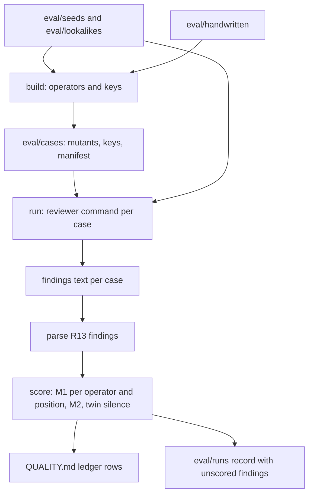

# Evaluation-Set Factory - Plan

## Goal Capsule

- **Objective:** The project can show, with evidence, whether the CLR review catches every seeded insufficient cause and missing side effect (milestone MS1), and how many false findings in those two categories it raises on trees with no seeded defect of that kind (metric M2).
- **Product authority:** This plan covers the first, smallest evaluation set: two mutation operators and the clean trees that M2 needs. The other eight operators, seeded strategy documents, and evaluation runs in CI are not active scope (see How This Work Fits Together).
- **Means:** Scripted operators on structured neutral seeds, a deterministic scorer, and a local run command with a pluggable reviewer (KTD1-KTD11).
- **Authority:** The Product Contract wins on behavior. The Planning Contract wins on mechanism within it. A unit overrides neither.
- **Execution profile:** One pull request. Unit tests run in CI; evaluation runs never do (R14).
- **Stop conditions:** Stop and report if an operator cannot make a mutant without a visible tell (KTD3), or if a seed cannot pass the second-agent check (R17).
- **Who finishes:** The implementing agent builds, tests, and opens the PR. The first real evaluation run waits for the CLR review skill (core-vocabulary plan) and is not part of this PR's Definition of Done.
- **Open blockers:** None.

---

## Product Contract

### Summary

Build a small factory that makes the first evaluation set. Scripted operators turn neutral clean seed trees into mutants with known defects, each with an answer key and a repaired twin. A local command runs the review on every tree, scores each finding by CLR category and entity ID, and adds the result to the QUALITY.md results ledger.

### Problem Frame

STRATEGY.md and QUALITY.md promise evidence that the review catches what an expert would catch. Milestone MS1, metric M1 (seeded-defect catch rate), and metric M2 (false findings on trees with no seeded defect) all depend on an evaluation set. No evaluation set exists, and the results ledger is empty. Until one exists, the claim "the review is accurate" in the strategy assurance case has no evidence, and the M1 floor of 100% cannot be checked.

The first set must stay small. The two defect kinds that slip through most often (cause insufficiency and missing side effects) are the ones MS1 names. A larger catalog before the first baseline run would delay the first evidence and add cost with no decision that depends on it.

### Key Decisions

- **The first set covers two operators, for MS1 only.** (session-settled: user-directed — chosen over the full 10-operator catalog, plan examples only, and strategy documents first: MS1 names these two defect kinds, and the first evidence comes sooner.) Governs R4, R5, R12.
- **A finding matches on CLR category and entity ID; wording is not scored.** (session-settled: user-directed — chosen over a model judge and over a person scoring by hand: the match is the same on every run and costs nothing.) Governs R10, R11.
- **Runs are on demand and local; results go to the QUALITY.md ledger.** (session-settled: user-directed — chosen over scheduled CI runs and runs on each pull request: no model keys in CI, and runs are not yet cheap or stable enough to gate merges.) Governs R14, R15.
- **M2 counts only the two MS1 categories.** Findings in the other six categories are logged and not scored in v1. (session-settled: user-directed — chosen over counting every finding and over a person labeling extra findings: the review checks all eight categories, but the set seeds only two.) Governs R13.
- **A clean seed draws its foreseeable negative branches, and a second agent checks it.** Without this, M2 counts correct side-effect findings as false. (session-settled: user-approved — chosen over leaving side-effect cleanliness to the seed author: the recommendation was accepted in document review.) Governs R17.
- **MS1 counts three runs per reviewer version; a miss in any run fails it.** (session-settled: user-approved — chosen over a single run: model output varies between runs.) Governs R18.
- **Mutants come from scripted operators on structured seeds; the clean seed is the repaired twin.** (session-settled: user-directed — chosen over recipe-guided writing and over a script plus a paraphrase pass: smallest build, same output on every run.) Governs R1, R4, R5, R6.

### Requirements

**Seeds**

- R1. Each seed is a clean, neutral tree in a structured form, with a stable ID on each entity and each arrow.
- R2. The first seeds include plan examples AE1 and AE2 from the core-vocabulary plan, rewritten as clean trees, plus new neutral seeds written for the two operators.
- R3. Every seed and every case names no real person, company, or private figure, and passes the neutrality check FF3 once it exists.

**Mutants and answer keys**

- R4. The insufficiency operator removes one condition from an AND group, so the remaining causes are not enough for the effect.
- R5. The side-effect operator deletes a negative branch below an action or injection.
- R6. Each mutant ships with an answer key (the CLR category, the match set of entity and arrow IDs, and a one-sentence expected finding for people to read) and names its clean seed as its repaired twin.
- R7. The set includes a few two-defect trees that use both operators, so a miss after the first finding shows up.
- R8. The set includes a few hand-written cases, so the review cannot pass by spotting tells in scripted mutants.

**Clean set**

- R9. The clean set holds the seeds and clean lookalikes: gates, cause AND NOT mitigation groups, and long but sufficient AND groups.
- R17. Each action or injection in a clean seed draws its foreseeable negative branches, and a second agent checks the seed for undrawn branches before it enters the set.

**Scoring**

- R10. A finding matches a key entry when its CLR category matches and the ID it names is in the entry's match set. For cause insufficiency, the match set is the effect, its incoming arrows, and its remaining causes; for a missing side effect, it is the action or injection.
- R11. Missing-side-effect findings use one fixed label, so the scorer can match them like a CLR category.
- R12. M1 is the share of seeded defects found, reported per operator and per defect position, never as one average.
- R13. M2 counts findings in the two MS1 categories on trees with no seeded defect of that kind; findings in other categories are logged with the run.

**Runs and results**

- R14. One local command runs the review on every case and scores it; no evaluation run is part of CI.
- R15. Each run adds one row per scored category to the QUALITY.md results ledger, with the reviewer version (skill text, vocabulary version, evaluation-set version, and model).
- R16. The review runs on every case as an agent, with no human present.
- R18. MS1 counts three runs per reviewer version, and a miss in any run fails MS1.

### Acceptance Examples

- AE1. **Covers R4, R10.** **Given** a mutant whose AND group lost one condition, **when** the review reports cause insufficiency on the effect, an incoming arrow, or a remaining cause, **then** the defect counts as found, whatever the sentence says.
- AE2. **Covers R6, R13.** **Given** the repaired twin of that mutant, **when** the review reports cause insufficiency on the same effect, **then** the finding counts as false for M2.
- AE3. **Covers R5, R11.** **Given** a mutant with a deleted negative branch, **when** the review reports the fixed side-effect label on the keyed action, **then** the defect counts as found.
- AE4. **Covers R9, R13.** **Given** a clean lookalike with a gate, **when** the review reports a clarity finding on it, **then** the finding is logged and does not change M2.
- AE5. **Covers R7, R12.** **Given** a two-defect tree, **when** the review finds only the first defect, **then** M1 counts one of two, and the result for the second defect position shows the miss.

### Success Criteria

- MS1 is met when, in every counted run (per R18), M1 is 100% for both operators and no repaired twin gets a finding of its key's category on its key's match set. This is the QUALITY.md rule that the review flags the mutant and stays silent on the twin. On a small set, one miss fails MS1; this is intended.
- The first run gives an M2 baseline, so the M2 floor decision can be made from data.
- The three runs per reviewer version give the data to set a stability tolerance for FF8.

### Scope Boundaries

**Deferred for later**

- The other eight operators in the QUALITY.md catalog.
- Seeded strategy documents for prose mapping.
- A paraphrase pass that rewrites mutant wording.
- Scheduled or pull-request evaluation runs, and any merge gate on an evaluation result.
- Scoring of findings in the six other CLR categories.

**Outside this work**

- The CLR review itself; it is built by the core-vocabulary plan.
- Structure checks; the tool repository owns them.

<!-- ce-section: work-relationships -->
### How This Work Fits Together

This plan covers the first evaluation set (track T4) for milestone MS1. The list below is the current understanding, not a committed roadmap.

- CLR review and core vocabulary (docs/plans/2026-11-11-1621-feat-core-vocabulary-clr-review-plan.md): This plan depends on it for runs. The factory and its keys can be built before the review exists. This plan answers that plan's deferred question about the first test set.
- Full operator catalog: Depends on this plan's seed format and scorer. Still to decide when the first baseline is in.
- Seeded strategy documents: Depends on the prose-mapping part of the review. Can proceed independently of the full catalog.
- Fitness function FF8 (scheduled evaluation floors): Depends on this plan's runs being cheap and stable.

### Dependencies / Assumptions

- The review gives findings in the form of core-vocabulary plan R13 (category, entity with ID in brackets, one sentence). R11 needs that plan's R10 to use a fixed label for a possible negative branch.
- ADR 0002 (agent author with no human) and ADR 0004 (vocabulary stability uses the evaluation floors) apply to this set.
- QUALITY.md's evaluation-set contract named the core-vocabulary plan's examples AE1-AE6 as the first seeds. Of those, only core-vocabulary AE1 and AE2 are defect seeds for the two operators, and core-vocabulary AE3 supplies a clean lookalike (cause AND NOT mitigation). Core-vocabulary AE4-AE6 test unreadable input, depth, and question mode, and stay out of v1. The contract text is corrected to match.

### Outstanding Questions

**Resolved in planning**

- The structured format for seeds, keys, and results: KTD1, KTD2.
- The number of seeds per operator and the number of two-defect and hand-written cases: KTD8.
- The wording of the fixed side-effect label: KTD4 (provisional until the core-vocabulary plan fixes it).
- How the run records the reviewer version: KTD7.

**Deferred to after the first baseline**

- The score tolerance between runs beyond which the reviewer counts as unstable. Three runs per reviewer version give the data (Success Criteria); R18 already fails MS1 on any miss, so no tolerance is needed to judge MS1.

### Sources / Research

- QUALITY.md (evaluation set contract, metric charter, results ledger)
- STRATEGY.md (MS1, M1, M2)
- ARCHITECTURE.md (FF3, FF8)
- docs/ideation/2026-11-12-testable-strategy-ideation.html (idea 3, evaluation-set factory)
- scripts/check-upload-limits.test.mjs (pattern for repository checks with temporary fixtures)

---

## Planning Contract

The Product Contract above is unchanged except for Outstanding Questions, which now points to the decisions below.

### Key Technical Decisions

- KTD1. **Trees, keys, and manifests are JSON files under `eval/`.** Node reads JSON with no new dependency. A tree has `entities` (each with `id`, `text`, `kind`, and `undesirable` when the effect is undesirable), `arrows` (each with `id`, `from`, `to`, and `not: true` for the mitigation in a cause AND NOT mitigation group), and `groups` (each an AND group with `id` and the arrow IDs it joins). Governs R1, R6.
- KTD2. **Generated cases are committed, and a test proves they match the generator.** The build script writes every mutant, key, and the case manifest into `eval/cases/`. A unit test rebuilds them in memory and fails on any difference. Reviewers can read every case in the PR, and the set version (KTD7) is a hash of committed files. Governs R4, R5, R6.
- KTD3. **Entity and arrow IDs are text slugs, and the operators leave no structural tell.** A slug ID (for example `late-deliveries`) shows no numbering gap when an entity is removed. The insufficiency operator removes one positive condition and its arrow, deletes the condition entity when nothing else uses it, and dissolves an AND group left with one arrow, so the mutant looks like an ordinary single-cause arrow. It never removes the `not` member of a group. The side-effect operator removes the branch root below an action or injection and every entity reachable only through it. Governs R4, R5.
- KTD4. **Two fixed category labels live in one module: `Cause insufficiency` and `Possible negative branch`.** The second comes from core-vocabulary plan R10 ("reports each undrawn effect as a possible negative branch"). It is provisional; if the core-vocabulary plan picks other wording, only this module and the committed keys change. Category matching ignores case and surrounding punctuation. Governs R10, R11.
- KTD5. **The reviewer is a shell command, and saved findings can be scored again.** The run command takes `--reviewer "<command>"`. It runs the command once per case with the case tree (entities, arrows, and groups only, with no key or operator data) on standard input, and reads findings from standard output. The command also takes `--findings <dir>` to score saved outputs without calling a reviewer, which is what the unit tests use. Governs R14, R16.
- KTD6. **Findings are parsed from the R13 finding form.** A finding line is the category, then the entity text with its ID in brackets, then one sentence (core-vocabulary plan R13). The parser drops list markers and markdown emphasis, takes the category before the first period or colon, and takes the first bracketed ID. Lines that do not parse are logged as unreadable, never dropped silently. Governs R10, R13.
- KTD7. **The reviewer version is four short hashes plus a model name.** The skill hash covers `skills/clr-review/` when it exists, else `none`; the vocabulary hash covers `vocabulary/` when it exists, else `none`; the set hash covers `eval/cases/` and `eval/handwritten/`; the model is the required `--model` value. The ledger shows it as `skill:<8> vocab:<8> set:<8> model:<name>`. Governs R15.
- KTD8. **Set size for v1: six clean seeds, four lookalikes, three two-defect trees, and three hand-written cases.** The six seeds are core-vocabulary AE1 and AE2 rewritten as clean trees plus four new neutral seeds. Each seed has at least one AND group of two or more positive conditions and at least one action or injection with its negative branch drawn. The insufficiency operator makes one mutant per AND group and the side-effect operator one per negative branch, so the set has roughly two dozen mutants. The lookalikes are one gate, one cause AND NOT mitigation group (from core-vocabulary AE3), and two long but sufficient AND groups. Governs R2, R7, R8, R9.
- KTD9. **Seed checks are recorded in the seed file, and the build refuses a seed without them.** Each seed, lookalike, and hand-written twin carries `checks.negativeBranches` (the date and result of the second-agent check, R17) and `checks.neutrality` (the date of the manual neutrality check, R3, until FF3 exists). The second-agent check is a separate agent that reads only the seed and lists undrawn foreseeable negative branches; the seed enters the set only when that list is empty or each item is drawn. Governs R3, R17.
- KTD10. **Unit tests run in a new CI workflow; evaluation runs stay local.** A new workflow runs `node --test scripts/eval/*.test.mjs` on Node 22, beside the existing upload-limits workflow. These tests call no model. Governs R14.
- KTD11. **The ledger writer appends rows to the QUALITY.md results ledger table.** It replaces the placeholder row on the first write and appends after the last table row on later writes. Each run adds one row for `Cause insufficiency` and one for `Possible negative branch`. M5 is written as `not measured`. Governs R15.

### High-Level Technical Design

Scoring rules per case, in order:

1. For each key entry, the defect counts as found when a parsed finding has the entry's category and names an ID in its match set (R10).
2. A finding in an MS1 category on a case whose key has no entry of that category counts toward M2 (R13). Clean seeds and lookalikes have empty keys.
3. A finding in an MS1 category that matches no key entry on a case that has an entry of that category is logged as unmatched and not scored. This keeps M2 to the R13 definition.
4. Findings in the other six categories, and unreadable lines, are logged with the run (R13).
5. Twin silence: for each mutant, the twin's findings (from the clean-set review in the same run) must hold no finding of the key's category on the key's match set. A breach fails MS1.

MS1 passes for a reviewer version when three runs (R18) each have M1 of 100% for both operators and no twin-silence breach.

### Assumptions

- The defect position in R12 is the ordinal of the defect in its case key: position 1 for single-defect trees, positions 1 and 2 for two-defect trees. Two-defect keys list the insufficiency defect first.
- The review skill will accept a tree as JSON on standard input. If it needs a file path instead, only the reviewer command string changes.
- The skill and vocabulary paths in KTD7 (`skills/clr-review/`, `vocabulary/`) follow ARCHITECTURE.md's repository layout. If the review skill ships elsewhere, update the paths in `version.mjs`, or every row reads `skill:none`.
- The clean seed is reviewed once per run and its findings serve both M2 and twin silence for every mutant built from it.

### Sequencing

U1 defines the tree format the other units read. U2 and U4 can be built in either order after U1. U3 needs U1 and U2. U5 needs U3 and U4. U6 needs U5.

---

## Implementation Units

### U1. Tree format, neutral seeds, and lookalikes

- **Goal:** Clean, neutral seed and lookalike trees exist in the KTD1 format and pass a structure check.
- **Requirements:** R1, R2, R3, R9, R17; KTD1, KTD3, KTD8, KTD9.
- **Dependencies:** None.
- **Files:**
  - `scripts/eval/tree.mjs`
  - `scripts/eval/tree.test.mjs`
  - `eval/seeds/*.json` (six seeds)
  - `eval/lookalikes/*.json` (four lookalikes)
- **Approach:**
  1. Write `tree.mjs` with a loader and a validator: unique slug IDs, arrows that name existing entities, groups that name existing arrows into one target, and the `checks` fields from KTD9.
  2. Write the six seeds. Rewrite core-vocabulary AE1 ("Late deliveries") and AE2 ("Add overtime shifts") as complete clean trees: AE1 gains the condition that makes its cause sufficient, and AE2 draws "Driver fatigue rises" as a negative branch.
  3. Write the four new seeds and the four lookalikes with invented, everyday scenarios that name no real person, company, place, or figure.
  4. Run the second-agent check on every seed and lookalike (KTD9), draw any branch it finds, and record the results in `checks`.
- **Patterns to follow:** `scripts/check-upload-limits.test.mjs` for node:test style and temporary fixtures.
- **Test scenarios:**
  - A valid tree loads and validates with no errors.
  - An arrow that names a missing entity fails validation and names the arrow ID.
  - A group whose arrows point to different targets fails validation.
  - A duplicate ID fails validation.
  - A seed missing `checks.negativeBranches` or `checks.neutrality` fails validation.
  - Every committed seed and lookalike validates.
  - Every committed seed has an AND group with two or more positive conditions and an action or injection with an undesirable child.
- **Verification:** All committed trees validate; the seeds meet the KTD8 shape.

### U2. Mutation operators and answer keys

- **Goal:** The two operators turn a seed into mutants with answer keys, and leave no structural tell.
- **Requirements:** R4, R5, R6, R10; KTD3, KTD4.
- **Dependencies:** U1.
- **Files:**
  - `scripts/eval/categories.mjs`
  - `scripts/eval/operators.mjs`
  - `scripts/eval/operators.test.mjs`
- **Approach:**
  1. `categories.mjs` exports the two fixed labels and a normalizer (KTD4).
  2. The insufficiency operator takes a seed and a group ID and returns the mutant plus a key entry: category `Cause insufficiency`, match set of the effect, its incoming arrows in the mutant, and its remaining causes (R10).
  3. The side-effect operator takes a seed and a branch root ID and returns the mutant plus a key entry: category `Possible negative branch`, match set of the action or injection.
  4. Each key names its twin by seed ID and holds a one-sentence expected finding for people to read (R6).
  5. Enumerators list every eligible group and branch root in a seed in a fixed order.
- **Test scenarios:**
  - Covers AE1. Removing one condition from a two-arrow AND group leaves a plain arrow with no group, deletes the condition entity, and keys the effect, the remaining arrow, and the remaining cause.
  - Removing one condition from a three-arrow group keeps a two-arrow group.
  - The operator never removes the `not` arrow of a cause AND NOT mitigation group.
  - A condition entity that also causes another effect stays in the mutant; only its arrow into this effect goes.
  - Covers AE3. Deleting a negative branch removes the branch root and its exclusive descendants, keeps a descendant that another path also reaches, and keys the action.
  - The mutant passes the U1 validator.
  - Running an operator twice on the same input gives identical output.
- **Verification:** Every operator output validates and carries a well-formed key.

### U3. Case build, hand-written cases, and drift check

- **Goal:** The full evaluation set is generated, committed, and provably in sync with the generator.
- **Requirements:** R6, R7, R8; KTD2, KTD8.
- **Dependencies:** U1, U2.
- **Files:**
  - `scripts/eval/build.mjs`
  - `scripts/eval/build.test.mjs`
  - `eval/handwritten/<case-id>/tree.json`, `key.json`, `twin.json` (three cases)
  - `eval/cases/<case-id>/tree.json` and `key.json` (generated)
  - `eval/cases/manifest.json` (generated)
- **Approach:**
  1. `build.mjs` applies every enumerated operator to every seed, then builds three two-defect trees by applying the side-effect operator to an insufficiency mutant at a location the first operator did not touch.
  2. It copies the hand-written cases in, validates each, and writes a manifest that lists every case with its kind (mutant, two-defect, hand-written, clean seed, lookalike), operator, twin, and key.
  3. Case IDs are derived from the seed ID and operator target, so they do not change between builds.
  4. The hand-written cases are written by hand with their own twins, and use the same two categories and match-set rules. Each hand-written twin is a clean case: the manifest lists it with kind `clean twin`, the run reviews it, and scoring uses it for M2 and twin silence.
- **Execution note:** Write the drift test before the first committed build, so the committed set is born in sync.
- **Test scenarios:**
  - Rebuilding in memory gives files identical to the committed `eval/cases/`.
  - Covers AE5. A two-defect key has two entries, insufficiency first, each with its own match set.
  - Every mutant's twin exists in the clean set.
  - The manifest lists every clean seed, lookalike, and hand-written twin with an empty key.
  - A hand-written case that fails validation stops the build with its case ID in the error.
- **Verification:** The committed set matches a fresh build, and the case counts match KTD8.

### U4. Finding parser and scorer

- **Goal:** Given findings per case, the scorer gives M1 per operator and position, M2, twin silence, and the logged remainder.
- **Requirements:** R10, R11, R12, R13; KTD4, KTD6.
- **Dependencies:** U1.
- **Files:**
  - `scripts/eval/findings.mjs`
  - `scripts/eval/score.mjs`
  - `scripts/eval/score.test.mjs`
- **Approach:**
  1. `findings.mjs` parses R13 lines into category, ID, and text (KTD6).
  2. `score.mjs` applies the scoring rules in the High-Level Technical Design to a manifest and a findings map, and returns a result per category with counts per operator and position, M2 counts, twin breaches, unmatched findings, and logged findings.
- **Test scenarios:**
  - `- **Cause insufficiency.** Late deliveries [late-deliveries]: one cause is not enough.` parses to that category and ID.
  - A line with no bracketed ID is returned as unreadable.
  - Covers AE1. A finding on the effect, on an incoming arrow, or on a remaining cause each counts the defect as found, whatever the sentence says.
  - A finding of the right category on an ID outside the match set does not count as found and is logged as unmatched.
  - Covers AE2. An insufficiency finding on the twin's keyed effect counts toward M2 and is a twin breach.
  - Covers AE3. A `Possible negative branch` finding on the keyed action counts as found.
  - Covers AE4. A clarity finding on a gate lookalike is logged and leaves M2 unchanged.
  - Covers AE5. A two-defect tree with only the first defect found gives 1 of 2, and position 2 shows the miss.
  - An insufficiency finding on a side-effect mutant counts toward M2.
- **Verification:** All acceptance examples pass as scorer tests.

### U5. Run command, reviewer version, ledger, and MS1

- **Goal:** One local command reviews every case, scores the result, writes a run record, adds ledger rows, and reports MS1 across three runs.
- **Requirements:** R14, R15, R16, R18; KTD5, KTD7, KTD11.
- **Dependencies:** U3, U4.
- **Files:**
  - `scripts/eval/run.mjs`
  - `scripts/eval/version.mjs`
  - `scripts/eval/ledger.mjs`
  - `scripts/eval/run.test.mjs`
  - `eval/runs/.gitkeep`
- **Approach:**
  1. `run.mjs` takes `--model` (required), `--reviewer` or `--findings`, `--runs` (default 3), and `--ledger` (default `QUALITY.md`).
  2. For each run it reviews every case (KTD5), saves the raw output per case under `eval/runs/<run-id>/`, scores it, and writes `eval/runs/<run-id>/result.json`.
  3. After all runs it prints MS1 pass or fail with the reason, and appends two ledger rows per run (KTD11) with the reviewer version (KTD7).
  4. A reviewer command that exits non-zero for a case marks that case as failed in the run record and stops the run with a message naming the case; no ledger row is written for an incomplete run.
- **Test scenarios:**
  - With a findings directory that finds every defect and stays silent on twins, MS1 passes and two rows per run are added.
  - With one run missing one defect, MS1 fails and the message names the run, the operator, and the case.
  - With a twin breach, MS1 fails even when M1 is 100%.
  - The ledger writer replaces the placeholder row on first write and appends on the second, leaving the rest of QUALITY.md unchanged.
  - The reviewer version shows `none` for the skill and vocabulary hashes when those folders do not exist.
  - A reviewer command such as `cat` (echoing the tree) yields no findings and a failed MS1, and the case input on standard input holds no key fields.
  - A reviewer command that exits non-zero stops the run and writes no ledger row.
- **Verification:** A full run with a fixture findings directory writes the run record and ledger rows; the tests use temporary copies of QUALITY.md.

### U6. CI workflow and documentation

- **Goal:** Unit tests guard the factory on every pull request, and the docs point to the set and the run command.
- **Requirements:** R14; KTD10.
- **Dependencies:** U5.
- **Files:**
  - `.github/workflows/eval-factory.yml`
  - `eval/README.md`
  - `ARCHITECTURE.md` (repository layout and building-block status for `eval/`)
  - `QUALITY.md` (evaluation set contract: where the set lives and how to run it)
- **Approach:**
  1. Copy the shape of `.github/workflows/upload-limits.yml`: pinned checkout and setup-node actions, Node 22, `contents: read`.
  2. `eval/README.md` covers the file format, how to add a seed (including the KTD9 checks), how to build, and how to run with a reviewer command.
  3. Update the status of the evaluation set in ARCHITECTURE.md and add the run command to the QUALITY.md contract.
- **Test expectation:** none -- CI configuration and documentation; the workflow runs the U1-U5 tests.
- **Verification:** The new workflow passes on the pull request.

---

## Verification Contract

| Gate | Command | Proves |
|---|---|---|
| Eval unit tests | `node --test scripts/eval/*.test.mjs` | Tree format, operators, build drift, parser, scorer, run command, ledger writer |
| Existing check | `node --test scripts/check-upload-limits.test.mjs` | Upload-limit fitness function still passes |
| CI | `.github/workflows/eval-factory.yml` and `upload-limits.yml` green on the PR | Both test suites pass on Node 22 |

No evaluation run against a model is part of verification (R14).

---

## Definition of Done

- Every unit's tests pass locally and in CI.
- `eval/cases/` matches a fresh build, and its counts match KTD8.
- Every seed and lookalike records both KTD9 checks.
- No seed, case, or fixture names a real person, company, or private figure (R3).
- No abandoned or experimental code is left in the diff.
- The first real evaluation run is not required; it waits for the CLR review skill.
